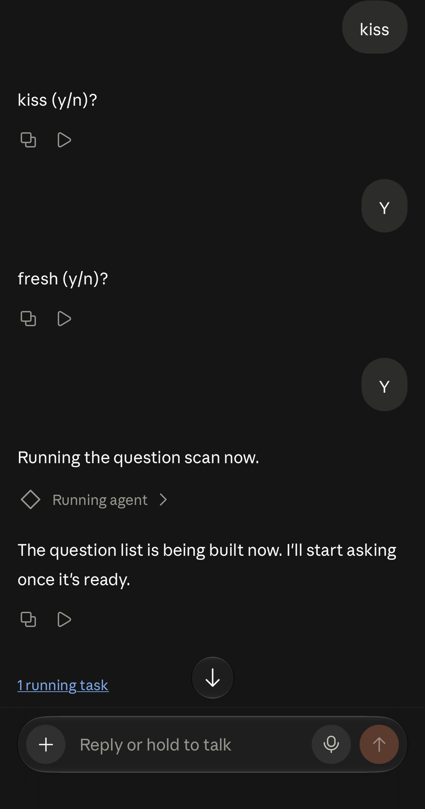
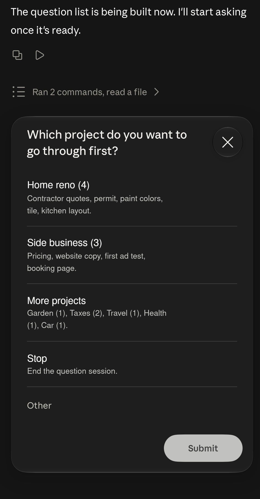
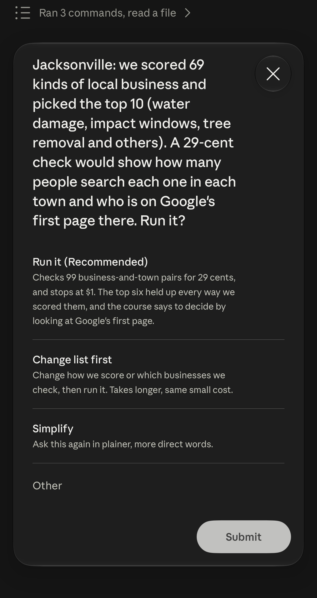

# kiss

A prompt that gives your AI assistant a `kiss` command. Type `kiss` and it finds every decision waiting on you in your notes or task app, asks them one at a time as simple multiple-choice questions, and writes your answers back where the tasks live.

## How to use

1. Open your AI agent in your notes folder (works best in Claude Code).
2. Paste in everything from [PROMPT.md](PROMPT.md).
3. Answer its few setup questions.
4. From then on, type `kiss` whenever you want to clear your decisions.

## What it looks like

Type `kiss`, confirm, and it scans your tasks. Then pick a project and answer one question at a time.

## What you get

- Works with markdown checklists, and with Notion, Todoist, GitHub Issues and others when your agent already has a way to reach them.
- One question at a time, recommended answer first, plus a "Simplify" option if a question is unclear.
- Each answer is saved with the date, in the same place as the task.
- It never deletes or moves your tasks.

## Good to know

- Setup writes the skill where your agent keeps its skills (in Claude Code, `~/.claude/skills/kiss/`) and adds its scan file to your ignore list.
- An answer can start work. If you pick an option that means "do it", the agent starts that work in the background and moves to the next question.
- Anything that spends money, or sends, posts or deletes outside your computer, still needs your explicit go.

MIT license. See [LICENSE](LICENSE).
